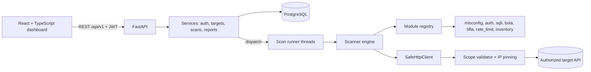
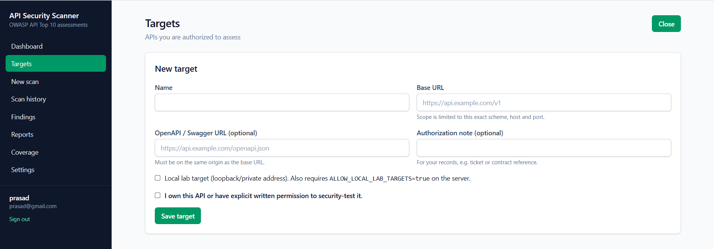
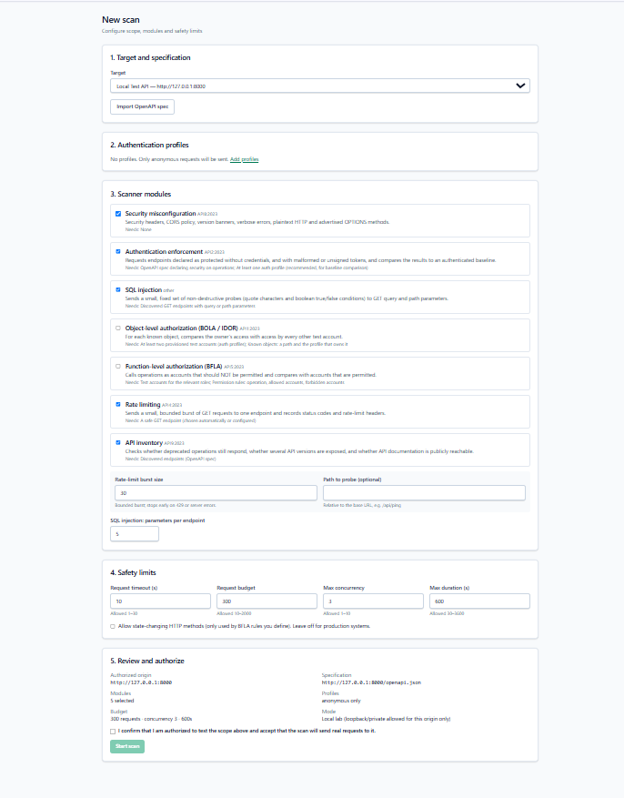

# API Security Scanner

A full-stack web application for assessing REST APIs against the **OWASP API Security Top 10 (2023)**.
Import an OpenAPI/Swagger spec, configure authorized targets and test accounts, run bounded and
non-destructive checks, review evidence-backed findings, and export HTML/JSON reports.

> **Ethical-use notice.** Use this tool only against systems you own or have explicit written
> permission to test. The application requires an authorization confirmation for every target and
> scan, but that is a safeguard, not a legal defence. You are responsible for how you use it.

## Features
* Registration/login with bcrypt, JWT sessions bound to a server-side session (revocable), rate limiting and per-account lockout.
* Target management with explicit authorization, scope = exact origin, encrypted target-API credentials (bearer, API key, test account).
* OpenAPI 3.x / Swagger 2.0 discovery (JSON or YAML) with endpoint, parameter, body and security-scheme extraction.
* Scanner modules: security misconfiguration, authentication enforcement, SQL injection, BOLA/IDOR, BFLA, rate limiting, API inventory.
* Every finding carries a **validation status** (confirmed / potential / informational / inconclusive), severity, confidence, remediation and sanitized evidence.
* Background scan runner with live progress, cancellation, time/request budgets and crash recovery.
* React dashboard: dashboard, targets, scan configuration, live progress, history, details, findings with filters, evidence, report export, coverage matrix, session management.
* Downloadable, HTML-escaped reports (HTML and JSON).

## Limitations (read before relying on results)
* OWASP **API3, API6, API7 and API10 are not automated**; API2, API4 and API9 are partial. See the in-app *Coverage* page and [docs/methodology.md](docs/methodology.md).
* SQL injection testing covers GET query/path parameters only (error-based and boolean differential). No blind/time-based or body injection.
* BOLA and BFLA need test accounts and a permission model that **you** provide; identifiers are never guessed.
* Absence of findings does not mean an API is secure. "Potential" findings need manual verification.
* Single-instance design: the rate limiter and scan runner are in-process (no Redis/Celery by design).
* Developed and tested with Python 3.12, Node.js 22, and PostgreSQL 16.

## Architecture

The scanner (`backend/app/scanner`) has no dependency on FastAPI or the database and is tested on its own.

```text
api-security-scanner/
├── backend/
│   ├── app/{core,api,db,models,schemas,services,scanner,reports,utils}
│   ├── lab/vuln_lab.py        # deliberately vulnerable demo API (loopback only)
│   ├── migrations/            # Alembic (0001 schema, 0002 scan progress)
│   └── tests/
├── frontend/                  # Vite + React + TypeScript + Tailwind
├── docs/                      # methodology, API reference, validation guide
├── docker-compose.yml         # PostgreSQL
└── .env.example
```

## Technology
Frontend: React 19, TypeScript, Vite, Tailwind CSS 4, React Router, Axios, Recharts, React Hook Form, Zod.
Backend: Python 3.12, FastAPI, Uvicorn, Pydantic, HTTPX, SQLAlchemy 2, Alembic, PostgreSQL, PyJWT, bcrypt, cryptography (Fernet), Jinja2, PyYAML, Pytest, Ruff.
Infrastructure: Docker Compose (PostgreSQL), `.env` configuration.

## Installation

### Prerequisites
Python 3.11–3.13 (3.12 recommended), Node.js 20.19+ or 22.12+, Docker (for PostgreSQL), Git.

### 1. Configuration
```powershell
# Windows PowerShell, from the project root
Copy-Item .env.example .env
# edit .env, then generate secrets (run with the backend venv active, see step 3):
python -c "import secrets; print(secrets.token_urlsafe(48))"                          # JWT_SECRET_KEY
python -c "from cryptography.fernet import Fernet; print(Fernet.generate_key().decode())"  # ENCRYPTION_KEY
```
Set `POSTGRES_PASSWORD`, `JWT_SECRET_KEY` and `ENCRYPTION_KEY`. Linux/macOS: use `cp .env.example .env`.

### 2. Database
```bash
docker compose up -d db          # PostgreSQL on 127.0.0.1:5433
```

### 3. Backend
```powershell
cd backend
py -3.12 -m venv .venv                 # Linux/Kali: python3 -m venv .venv
.\.venv\Scripts\Activate.ps1           # Linux/Kali: source .venv/bin/activate
pip install -r requirements.txt
alembic upgrade head                   # create/upgrade the schema
uvicorn app.main:app --reload --port 8000
```
API docs: http://127.0.0.1:8000/docs

### 4. Frontend
```bash
cd frontend
npm install
npm run dev                            # http://localhost:5173 (proxies /api to :8000)
npm run build                          # production build in frontend/dist
```

### 5. Tests and lint
```bash
cd backend
pytest                                 # SQLite, hermetic
# Optional: run the same tests on PostgreSQL (database name MUST end in _test; tables are dropped)
#   $env:TEST_DATABASE_URL = "postgresql+psycopg://apisec:<password>@localhost:5433/apisec_test"
ruff check . ; ruff format --check .
cd ../frontend ; npm run typecheck
```

## Try it safely on the bundled lab
See [docs/validating-with-crapi.md](docs/validating-with-crapi.md). In short: run
`python -m lab.vuln_lab --port 8099`, set `ALLOW_LOCAL_LAB_TARGETS=true`, add the lab as a *Local lab* target and scan it.

## OWASP API Security Top 10 coverage
| Category | Support | Module(s) | Notes |
|---|---|---|---|
| API1 BOLA | Supported | `bola` | Needs ≥2 test accounts and known objects |
| API2 Broken Authentication | Partial | `auth` | Enforcement and token validation only |
| API3 BOPLA | Unsupported | - | Manual review |
| API4 Resource Consumption | Partial | `rate_limit` | Small bounded burst; never DoS |
| API5 BFLA | Supported | `bfla` | Needs your permission rules |
| API6 Business Flows | Unsupported | - | Manual |
| API7 SSRF | Unsupported | - | Needs out-of-band validation |
| API8 Misconfiguration | Supported | `misconfig`, `sqli` | Injection mapped to "other" (not an OWASP 2023 category) |
| API9 Inventory | Partial | `inventory` | Cannot find shadow APIs |
| API10 Unsafe Consumption | Unsupported | - | Manual |

## Screenshots




## Example report structure (JSON)
```json
{
  "report_version": "1.0",
  "generated_at": "...", "scanner": {"name": "...", "version": "..."},
  "scan": {"id": "...", "status": "completed", "started_at": "...", "requests_made": 120},
  "target": {"name": "...", "base_url": "...", "authorized_scope": {"origin": "..."}, "authorization_confirmed_at": "..."},
  "configuration": {"modules": ["..."], "auth_profiles": [{"name": "...", "role_label": "..."}], "settings": {}},
  "summary": {"total_findings": 0, "by_severity": {}, "by_status": {}, "endpoints_discovered": 0},
  "coverage": {"modules": [], "owasp": []},
  "endpoints": [{"method": "GET", "path": "/orders/{id}", "authentication_required": true, "findings": 1}],
  "findings": [{"title": "...", "category": "API1:2023", "severity": "high", "confidence": "high", "status": "confirmed",
                "endpoint": {"method": "GET", "path": "..."}, "description": "...", "remediation": "...",
                "evidence": [{"request": "...", "response_status": 200, "response": "..."}]}],
  "inconclusive_tests": [], "notes": [], "limitations": ["..."]
}
```

## Security notes for deployers
* Keep `ALLOW_LOCAL_LAB_TARGETS=false` on any shared deployment.
* Put the API behind HTTPS; the dashboard keeps its token in `sessionStorage` (cleared when the tab closes).
* Back up `ENCRYPTION_KEY`; rotating it requires re-entering stored target credentials.
* Run with a single backend process (rate limiting and scan runner are in-process).

## License
MIT - see [LICENSE](LICENSE).
